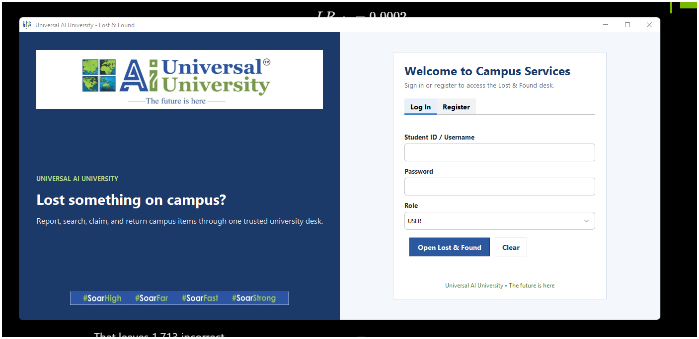
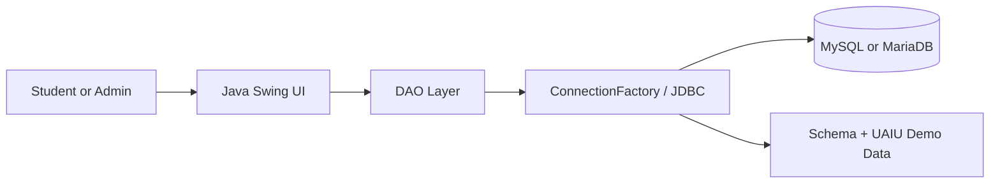

<div align="center">
  

  # CampusTrace UAIU

  **A one-click campus lost-and-found desktop system for Universal AI University.**

  [](https://adoptium.net/)
  [](https://docs.oracle.com/javase/tutorial/uiswing/)
  [](https://www.mysql.com/)
  [](https://netbeans.apache.org/)
  [](https://github.com/jeelsoni01/CampusTrace-UAIU/actions/workflows/build.yml)

  [Features](#features) • [Quick start](#quick-start) • [NetBeans](#run-with-netbeans) • [Architecture](#architecture) • [Contributing](#contributing)
</div>

---

CampusTrace UAIU is a Java Swing application for reporting, searching, claiming, and handing over items lost around the Universal AI University campus. It combines a branded blue, white, and green interface with role-based workflows, JDBC persistence, and a one-click Windows launcher that can start XAMPP MySQL automatically.

> **Academic project:** This repository is a student project personalized for Universal AI University. It is not an official university service unless formally adopted by the institution.

## Preview

<div align="center">
  
</div>

## Features

- **Role-based access** for users and administrators
- **Lost-item reporting** with category, date, campus location, finder, contact, and description
- **Fast discovery** through keyword search, combined filters, sorting, pagination, and detailed views
- **Claim workflow** covering unclaimed, claimed, and handed-over states
- **Ownership controls** so users can manage their own reports while administrators manage all records
- **Campus-ready sample data** with Indian names and Universal AI University locations
- **Automatic database setup** for a standard local XAMPP MySQL/MariaDB installation
- **NetBeans-ready Ant project** plus standalone PowerShell and CMD scripts
- **One-click launch** that starts MySQL, compiles changed sources, and opens the application

## Quick start

### Prerequisites

- Windows 10 or 11
- JDK 17 or newer available on `PATH`
- [XAMPP](https://www.apachefriends.org/) installed at `C:\xampp`, or another MySQL/MariaDB server on port `3306`

### Run

```powershell
git clone https://github.com/jeelsoni01/CampusTrace-UAIU.git
cd CampusTrace-UAIU
.\launch-uaiu-lost-and-found.ps1
```

Or double-click **`Launch UAIU Lost and Found.cmd`**. On the first run, the application creates `LostFoundDB`, initializes its tables, and loads demo data without deleting existing user-created reports.

### Demo accounts

| Role | Username | Password |
| --- | --- | --- |
| User | `user` | `user` |
| Administrator | `admin` | `admin` |

These accounts are for local demonstration only. Change their passwords before using the application with real data.

## Run with NetBeans

1. Open Apache NetBeans.
2. Select **File → Open Project** and choose the cloned repository folder.
3. Start MySQL in XAMPP.
4. Select **Run → Clean and Build Project**.
5. Run the project. The main class is `com.campus.lostandfound.UI.LoginPage`.

The project uses the included Ant configuration and bundled JAR dependencies, so no Maven setup is required.

## Other build options

```powershell
# Compile with JDK 17
.\compile.ps1

# Compile if needed, then run
.\run.ps1
```

CMD equivalents are provided as `compile.cmd` and `run.cmd`.

## Database configuration

The defaults match a standard local XAMPP installation:

```text
LOSTFOUND_DB_URL=jdbc:mysql://localhost:3306/LostFoundDB?useSSL=false&allowPublicKeyRetrieval=true&serverTimezone=UTC&characterEncoding=utf8
LOSTFOUND_DB_USER=root
LOSTFOUND_DB_PASSWORD=
```

Override them with environment variables or matching JVM system properties when your database uses different credentials. For example:

```powershell
$env:LOSTFOUND_DB_USER = "campustrace"
$env:LOSTFOUND_DB_PASSWORD = "your-password"
.\run.ps1
```

You can also initialize the database manually with [`SQL/LostFoundDB.sql`](SQL/LostFoundDB.sql). The script works with MySQL 8 and the MariaDB version bundled with XAMPP.

## Architecture



| Layer | Responsibility |
| --- | --- |
| `UI` | Login, registration, dashboard, item forms, search, claims, and history |
| `DAO` | Parameterized JDBC queries and application permissions |
| `DTO` | User and lost-item data transfer objects |
| `Database` | Connection handling, schema initialization, migration, and sample data |
| `SQL` | Manual database initialization and optional personalization scripts |

## Project structure

```text
CampusTrace-UAIU/
├── assets/                 # Application and shortcut artwork
├── docs/screenshots/       # Repository preview images
├── lib/                    # Bundled runtime dependencies
├── nbproject/              # NetBeans Ant project configuration
├── SQL/                    # MySQL/MariaDB initialization scripts
├── src/com/campus/lostandfound/
│   ├── DAO/
│   ├── DTO/
│   ├── Database/
│   └── UI/
├── build.xml
├── compile.ps1
├── run.ps1
└── launch-uaiu-lost-and-found.ps1
```

## Security notes

- Demo passwords are intentionally simple and stored as plain text for classroom use.
- Do not use the demo configuration for sensitive or internet-facing deployments.
- Use a dedicated database account instead of MySQL `root` for non-demo installations.
- Never commit real database passwords or personal lost-item information.

## Contributing

Contributions and improvement ideas are welcome. Read [CONTRIBUTING.md](CONTRIBUTING.md), create a focused branch, and open a pull request with a clear explanation and verification steps.

## Attribution and usage

This academic project was adapted from [AsjadIqbal/InventoryManagementSystem](https://github.com/AsjadIqbal/InventoryManagementSystem) and later evolved into a campus lost-and-found workflow. See [NOTICE.md](NOTICE.md) for details.

No open-source license is currently granted for this repository. The source is public for academic review and demonstration; third-party libraries and brand assets remain subject to their respective owners' terms.

---

<div align="center">
  <strong>Built for safer, simpler campus item recovery.</strong><br>
  <sub>Java • Swing • JDBC • MySQL/MariaDB • NetBeans</sub>
</div>
